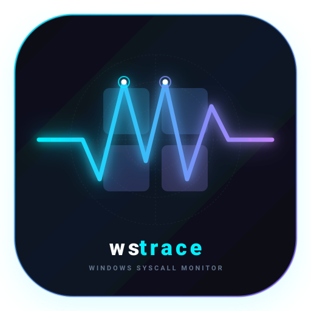

<p align="center">
  
</p>

<h1 align="center">wstrace</h1>

<p align="center">
  <strong>High-performance zero-driver Windows system and API monitor in Rust.</strong>
</p>

<p align="center">
  <a href="LICENSE"></a>
  <a href="https://github.com/sponsors/gilnett"></a>
  <a href="https://ko-fi.com/gilnet"></a>
</p>

<p align="center">
  Modern <code>strace</code> and real-time Process Monitor for Windows. Built in native Rust with zero kernel drivers required, featuring a real-time terminal user interface (TUI) and unbuffered streaming for headless diagnostics.
</p>

---

## Installation

### 1. PowerShell One-Liner (Zero-Clone)

Run in PowerShell to automatically install the latest release to `$HOME\.local\bin` and add it to your User `PATH`:

```powershell
irm https://raw.githubusercontent.com/gilnett/wstrace/main/packaging/install.ps1 | iex
```

### 2. Standalone Binary (GitHub Releases)

Download precompiled standalone binaries from [GitHub Releases](https://github.com/gilnett/wstrace/releases).

### 3. Cargo (From Source)

Install directly from GitHub:

```powershell
cargo install --git https://github.com/gilnett/wstrace.git
```

Or build locally from a cloned repository:

```powershell
cargo build --release
```

The resulting binary is located at `target\release\wstrace.exe`.

### 4. Package Managers (Winget & Scoop)

> [!NOTE]
> Winget and Scoop manifests are synchronized automatically with published GitHub Releases.

#### Windows Package Manager (Winget)

Once published in the official [microsoft/winget-pkgs](https://github.com/microsoft/winget-pkgs) repository:

```powershell
winget install gilnett.wstrace
```

To test locally using the repository manifest:

```powershell
winget install --manifest .\packaging\winget\wstrace.yaml
```

#### Scoop

```powershell
scoop install .\packaging\scoop\wstrace.json
```

---

## Quickstart & Usage

### 1. Verification

Confirm that `wstrace` is accessible in the current shell:

```bash
wstrace --version
```

### 2. Trace an Application (Interactive TUI)

Launch a target executable with real-time Win32 and system telemetry:

```bash
wstrace run <executable_path> [-- <arguments>...]
```

#### TUI Keyboard Controls

| Key | Action | Description |
| :--- | :--- | :--- |
| `Ctrl+C` | **Copy Selected** | Copies the highlighted event details into the Windows clipboard. |
| `Ctrl+A` | **Copy All** | Copies all currently filtered events into the Windows clipboard. |
| `Ctrl+E` / `Space` | **Pause / Resume** | Freezes the event view without dropping incoming telemetry. |
| `Ctrl+X` | **Clear Buffer** | Empties the current event list from the display buffer. |
| `Tab` | **Category Cycle** | Filters events: `ALL` -> `FILE` -> `REG` -> `NET` -> `PROC`. |
| `f` | **Failures Only** | Restricts view to failed operations (e.g. access denied, not found). |
| `Up` / `Down` | **Navigation** | Selects an event for deep inspection. |
| `q` / `Esc` | **Exit** | Terminates the tracing session cleanly. |

### 3. Trace All System-Wide Activity

Monitor active processes, new spawns, exits, and loaded modules system-wide in real time:

```bash
wstrace all
```

### 4. Attach to a Running Process

Attach to an existing process by PID or binary name without restarting it:

```bash
# Attach by PID
wstrace attach -p <PID>

# Attach by process name
wstrace attach -n <process_name.exe>
```

### 5. Headless Stream Mode (CI/CD & Logging)

Writes live events directly to `stdout` with ANSI color codes:

```bash
wstrace -m stream [-d <seconds>] run <executable_path>
```

---

> **Comprehensive Manual & Advanced Options:**
> For advanced path filtering (`--include` / `--exclude`), child tracking (`-C`), JSON reports (`--export-json`), clipboard exports (`--copy`), and scripting options, consult the **[CLI Reference Manual](docs/CLI_REFERENCE.md)** or run `wstrace --help`.

---

## Architecture & Compatibility

- **Core Engine:** Rust (2021 Edition)
- **Installer & Deployment:** PowerShell (`packaging/install.ps1`)
- **Terminal UI:** Ratatui + Crossterm
- **Telemetry Ingestion:** Win32 APIs (`ToolHelp32Snapshot`, `OpenProcess`, `VirtualQueryEx`) & Event Tracing for Windows (`ETW`).
- **Target Architectures:**
  - `x86_64-pc-windows-msvc` (Intel / AMD 64-bit)
  - `aarch64-pc-windows-msvc` (Qualcomm Snapdragon X / Windows on ARM)

---

## Enterprise Compliance & Institutional Governance

`wstrace` is engineered to meet strict institutional requirements for deployment in high-security enterprise environments (banking, defense, healthcare, and critical infrastructure):

### 1. Zero Cloud Data Leakage (Air-Gapped & Sovereign)
`wstrace` is 100% offline and standalone. It maintains zero remote servers, initiates zero telemetry or analytics, and performs zero outbound network calls. Any sensitive data observed during live tracing (API tokens, file paths, credentials, memory contents) remains strictly confined to local RAM and never leaves the workstation.

### 2. Zero Kernel Drivers (Zero Ring-0 Footprint)
Unlike traditional tracing utilities that install third-party `.sys` kernel drivers—introducing system crash risks (Blue Screen of Death / BSOD) and ring-0 backdoor attack surfaces—`wstrace` operates with zero kernel drivers. It relies exclusively on non-invasive userland Win32 debugging and native Windows Kernel ETW consumer interfaces.

### 3. Strict Local Access Control & Session Isolation
Trace telemetry is strictly bounded by the Windows user session and Mandatory Integrity Control (MIC) boundaries. Unprivileged user sessions cannot access or inspect higher-integrity processes without explicit administrator elevation, adhering strictly to the principle of least privilege.

### 4. Regulatory & Standard Alignment
- **SOC 2 Type II & ISO/IEC 27001 Alignment:** Complete data sovereignty, zero external data egress, and auditable build provenance.
- **GDPR (RGPD) & CCPA Compliance:** *Privacy by Design* architecture. Zero personal data collection, profiling, tracking, or commercialization.
- **EU Cyber Resilience Act (CRA) Readiness:** Documented security disclosure policy ([SECURITY.md](.github/SECURITY.md)), automated CVE dependency scanning via Dependabot, and third-party license audit inventory ([THIRD_PARTY_LICENSES.md](THIRD_PARTY_LICENSES.md)).
- **OWASP Rule #1 Compliance:** Zero hardcoded secrets, credentials, or private API keys across the codebase and version control history.

---

## License & Intellectual Property Governance

- **Software License:** Licensed under the [GNU General Public License v3.0](LICENSE) (GPL-3.0-or-later).
- **Contributor License Agreement (CLA):** All external contributions are subject to the terms outlined in [CONTRIBUTING.md](CONTRIBUTING.md), ensuring unified copyright ownership and protecting corporate acquisition (M&A) and commercial dual-licensing rights.

---

## Acknowledgements & Third-Party Credits

`wstrace` is proud to build upon the Rust open-source ecosystem and acknowledges the following foundational libraries:
- [Ratatui](https://github.com/ratatui/ratatui) (MIT) — Modern terminal user interface (TUI) layout and rendering engine.
- [Crossterm](https://github.com/crossterm-rs/crossterm) (MIT) — Cross-platform terminal manipulation and raw input control.
- [windows-sys](https://github.com/microsoft/windows-rs) (MIT / Apache-2.0) — Official Microsoft Win32 and Kernel ETW API bindings.

For complete license notices and terms, see [THIRD_PARTY_LICENSES.md](THIRD_PARTY_LICENSES.md).

---

## Support & Sponsorship

If you find `wstrace` useful for your Windows engineering, security audits, or performance debugging, you can support development via GitHub Sponsors or Ko-fi:

[](https://github.com/sponsors/gilnett)
[](https://ko-fi.com/gilnet)

- **GitHub Sponsors:** [https://github.com/sponsors/gilnett](https://github.com/sponsors/gilnett)
- **Ko-fi:** [https://ko-fi.com/gilnet](https://ko-fi.com/gilnet)


